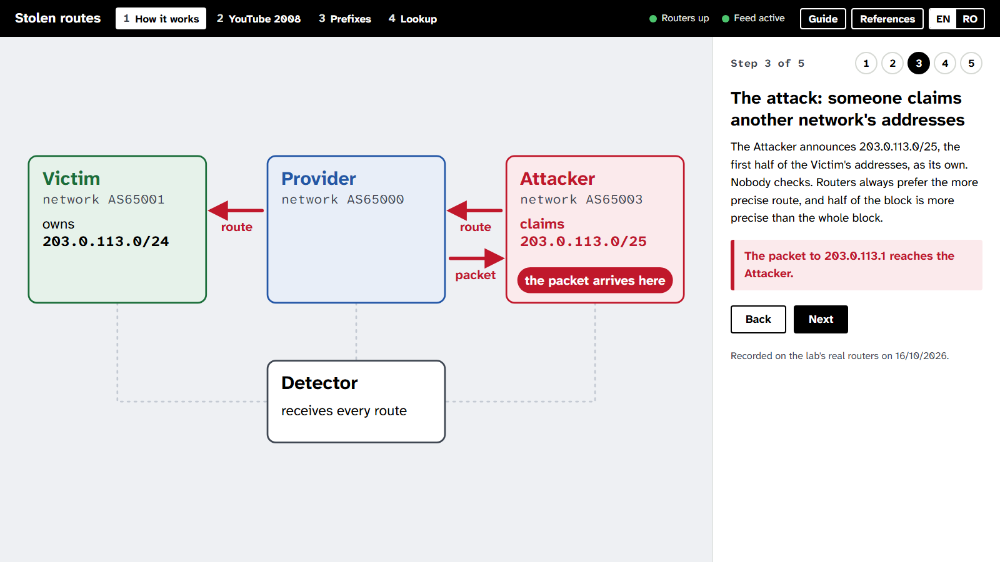
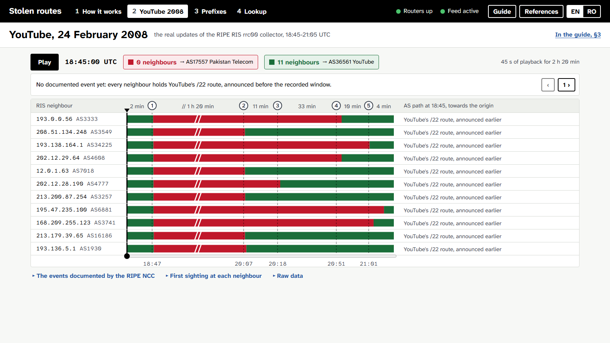
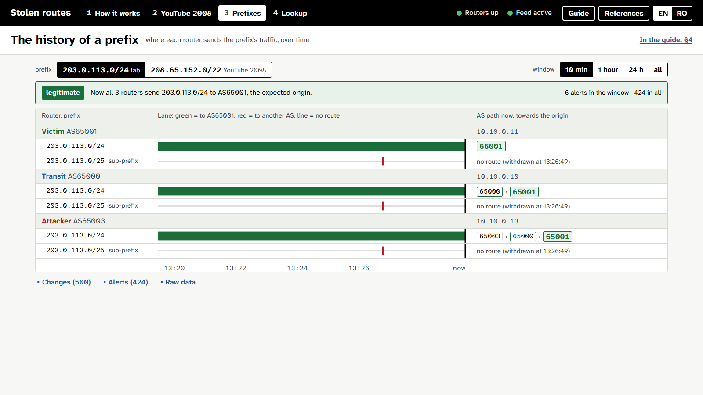
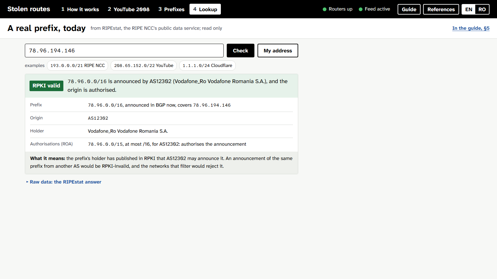
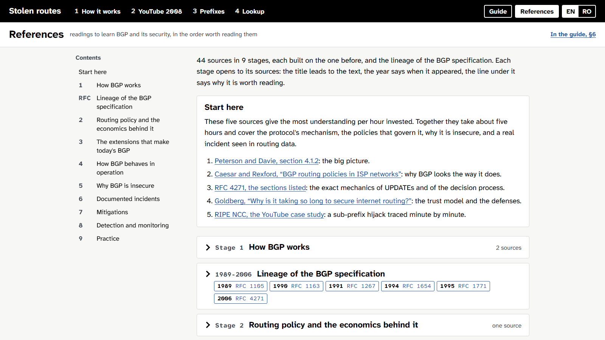

# BGP route hijack detector

**English** | [Română](README.ro.md)

A course project for PTIRC (TCSI master's programme, National University of Science and Technology POLITEHNICA Bucharest), theme 9. A defensive detector: it watches the BGP announcements for the monitored prefixes and raises an alert when another autonomous system announces them. The technique is the one used by ARTEMIS (FORTH-ICS) and BGPalerter (NTT).

It detects three situations:

- **false origin**: the exact prefix, announced by an AS that does not hold it;
- **sub-prefix**: a more specific part of the prefix, announced by a foreign AS;
- **RPKI-invalid**: an announcement that no route origin authorisation (ROA) allows.

Components: a lab of three FRR routers that report their routes over BMP (BGP Monitoring Protocol) to a monitoring station; the BGPWatch application in C# (the BMP station, the detector, the web pages); a Postgres database for the route and alert history; and a BGP parser in C that decodes both the lab's messages and the real data of the RIPE RIS archive.

**Live demo:** <https://student-dev.ro/bgp/> (the application), [`/guide`](https://student-dev.ro/bgp/guide) (the guide to read), [`/references`](https://student-dev.ro/bgp/references) (the readings). The site is in English by default; the **EN | RO** toggle in the top bar, or `?lang=ro` in the address, switches it to Romanian and remembers the choice.



## Screenshots

| | |
|---|---|
|  |  |
| **YouTube 2008**, replayed from the real RIPE RIS rrc00 updates | **Prefixes**: where each router sends the prefix, over time |
|  |  |
| **Lookup**: a real prefix, with its origin and RPKI state from RIPEstat | **References**: 44 sources in 9 stages |

`python scripts/screenshots.py` rewrites them, in English into `media/` and in Romanian into `media/ro/` (from the public instance by default; `--url http://localhost:8080/` for a local one).

## Stack

| Layer | What it uses |
|---|---|
| Lab | FRRouting 10.4 in Docker Compose, internal network `10.10.0.0/24`, BMP Loc-RIB (RFC 7854, RFC 9069) |
| Parser | C11, a shared library (`libmrt.so`, `mrt.dll`): MRT (RFC 6396) and BGP UPDATE, IPv4 and IPv6, AS4_PATH; every read bounds-checked, every failure reported |
| Application | C# on .NET 10: ASP.NET Core, Razor Pages, a minimal JSON API, P/Invoke to the parser, the Docker Engine API over its socket |
| Languages | a C# translation service over one JSON file per language (`Localization/strings.en.json`, `strings.ro.json`), shared by the pages and the browser modules |
| Data | PostgreSQL 16 through Npgsql (binary COPY, no ORM); the RIPEstat Data API, with a 10-minute cache |
| Page | ES modules without a framework, SVG, the Atkinson Hyperlegible Next and Mono fonts |
| Tests and checks | xUnit v3, Playwright for Python, ASan and UBSan for the parser |

## Isolation guarantees

- The lab network is internal (`internal: true` in `lab/docker-compose.yml`), with no uplink. No announcement leaves the machine.
- The routers use private AS numbers (65000, 65001, 65003) and the documentation prefix `203.0.113.0/24` (RFC 5737). The BMP station only listens: it has no BGP session and announces nothing.
- The lab hijack is a test: the "attacker" router announces the prefix only inside this closed network.
- The 2008 replay reads a recorded file. It contacts no network.
- Locally the page is published on a port of the machine; on the server it is served under the `/bgp` prefix. In both cases it drives the lab through the Docker socket, so anyone who sees the page can trigger and reset the test hijack, and nothing else.
- No real packet crosses the lab: Docker drops packets addressed outside the subnet of an internal network. "Ask the kernels" reads each router's routing decision instead of sending packets.
- The lookup view asks RIPEstat (`stat.ripe.net`) about a real prefix; it is the page's only request to the Internet, and it only reads.

## Install, start, stop

Running the application needs only Docker. The other dependencies (the .NET 10 SDK, gcc, Python with Playwright) serve the tests and the scripts in `scripts/`.

### Install

- **Windows 10/11:** double-click `install.bat`. It installs Docker Desktop, the .NET 10 SDK, MSYS2 with gcc and Python 3.12 through winget, then Playwright with Chromium and the NuGet packages, and skips what is already there. After the first install of Docker Desktop, restart the computer once (it needs WSL 2).
- **Debian or Ubuntu:** `sh scripts/install-linux.sh` from the repository root. It installs Docker Engine with the compose plugin, `build-essential`, the .NET 10 SDK in `~/.dotnet` and a `.venv` with Playwright and Chromium.

### Start and stop

- **Windows:** double-click `start.bat`. It starts Docker Desktop if it is stopped, then the lab and the detector, and opens the page. The page keeps the port of a stack already running, or takes the first free local port from 8080 to 8099. The first start builds the images and takes a few minutes. To stop, double-click `stop.bat`; the route history and the alerts stay in the Docker volume.
- **Linux or macOS**, from the repository root (`BGP_PORT` picks the local port, 8080 when unset):

```sh
# start: the lab, then the detector (BMP station, Postgres, the page)
docker compose -f lab/docker-compose.yml up -d
BGP_PORT=8080 docker compose up -d --build --remove-orphans

# stop
docker compose down
docker compose -f lab/docker-compose.yml down
```

### Useful Docker commands

```sh
docker compose ps                                   # state of the application and the database
docker compose logs -f app                          # the application's log
docker compose port app 8080                        # the local port the page is published on
docker compose -f lab/docker-compose.yml ps         # the three routers
docker exec lab-transit vtysh -c "show ip bgp"      # the transit router's BGP table
docker exec lab-transit vtysh -c "show bmp"         # its BMP session to the station
docker compose -f lab/docker-compose.yml up -d --force-recreate   # after a change in lab/frr/
docker compose down -v                              # stop and DELETE the Postgres history
```

The Postgres password in `docker-compose.yml` (`bgp`) is the default of the local demo; the database publishes no port.

## What each part does

The home page is the application: four views in the top bar (How it works, YouTube 2008, Prefixes, Lookup) and the "Guide" and "References" buttons. The guide (`/guide`) is six short chapters to read from top to bottom, each with one still figure of the lab at a chosen moment and a link to its step of the story; every view of the application links to its chapter of the guide. In the guide, the dotted-underlined terms open a definition. The references (`/references`) are the readings for learning BGP, in stages, with the lineage of the specification from RFC 1105 to RFC 4271.

1. **How it works.** A route hijack in five steps, for a reader who has never heard of BGP: a still map of the lab on the left, one panel of text on the right, "Back" and "Next" (or the numbered dots) to move. The steps: a network announces its addresses, a packet goes where the routes say, the attacker claims half of the block and the packet reaches it, the detector raises an alert (with the real delay), and the provider's origin validation against the RPKI refuses the attacker's routes. Every fact comes from one cycle recorded on the lab's real routers (`static/story/cycle.json`, written by `scripts/record_story.py`), so the story works with the lab down. On the last step, "Run the attack on the real routers" announces the sub-prefix on the lab, reports when the detector raised its alert and where the packet went, and withdraws the attack. `#step-N` opens step N.
2. **YouTube 2008.** The whole incident on one screen: one row for each of the 11 neighbours of the rrc00 collector, with a lane showing where it sent the traffic for the hijacked block (red to AS17557, green to YouTube) and, on the right, the AS path at the chosen moment, with the autonomous system that hands the route to the origin framed. The lane axis is cut into phases at the five documented events: each phase is as wide as the square root of its duration, with the real duration written above it, and the much compressed phase (the 80 minutes of the hijack) carries the // break mark. Above sit "Play" (the cursor moves at one speed along the lane, and the label shows the current phase's pace), the time and how many neighbours send to each origin, then the RIPE NCC's documented event at the chosen moment, with buttons to the previous and the next. Dragging on the lanes or on the bar under them scrubs. The events, the first sighting at each neighbour and the raw data sit closed under the table. The real BGP updates (18:45-21:05 UTC, 136,344 updates) load once at start; the detector raises 31 sub-prefix alerts, the first at 18:47:57 UTC. "Reload the incident from its files", in the raw data, rewrites them without duplicates.
3. **The history of a prefix.** The watched prefix and the window (10 min, 1 hour, 24 h, all) are chosen at the top. The verdict says where each router sends the prefix now. Below, each router has one row for every prefix it saw (the watched prefix and its sub-prefixes), with the lane over the window (green to the expected origin, red to another AS, a thin line for no route) and its path now. The changes, the alerts and the raw data sit closed below.
4. **A real prefix.** A prefix or an address typed in, an example, or "My address". The answer starts with the RPKI verdict, then the covering prefix, the origin, the holder, the authorisations (ROAs) and what the RPKI state means, from RIPEstat. It is the page's only request to the Internet, and it only reads.

## Further reading

- `src/BGPWatch.Web/Reading/readings.en.md` and `readings.ro.md`: the BGP reading list, in English and in Romanian, in stages, with the lineage of the specification; the `/references` page is generated from them.
- `detector/incidents/youtube-2008/config.toml`: the source of the replayed data, the monitored prefix and the documented timeline of the incident, in both languages.

## Layout

- `lab/`: the FRR configurations and the scripts that start and stop the test hijack.
- `src/BGPWatch.Core/`: the core, with no dependencies: the domain model, detection, grouping alerts into incidents, the history of a prefix, the use cases.
- `src/BGPWatch.Web/`: the adapters and the host: the BMP station, the binding to the C parser, Postgres, Docker, RIPEstat, the API, the translation service (`Localization/`) and the pages (Razor Pages, `wwwroot/static/`).
- `tests/BGPWatch.Tests/`: the unit tests.
- `detector/mrt/`: the BGP and MRT parser in C, with its sanitizer fuzz harness.
- `detector/incidents/`, `detector/config.toml`, `detector/schema.sql`: the 2008 incident's data, the lab configuration and the database schema.
- `scripts/`: the installers, the page check, the lab measurements, the parser fuzzing, the screenshots in `media/`.
- `docker-compose.yml` is the production shape; `docker-compose.override.yml` (loaded by default) adds the local port and the files mounted from the working tree; `docker-compose.server.yml` and `deploy/nginx-bgp.conf` are the server layer.

## Tests and checks

- Unit tests: `sh detector/mrt/build.sh`, then `dotnet test --solution BGPWatch.slnx`.
- Page check, with the stack running: `python scripts/check_page.py` (both languages at 390, 1366 and 1920 px: overflow, script errors, map text size and collisions, token contrast, emoji).
- Parser fuzzing under ASan and UBSan: `python scripts/fuzz_mrt.py 20000`.

## License

MIT, see [LICENSE](LICENSE). The vendored Atkinson Hyperlegible fonts are under the SIL Open Font License; the 2008 RIPE RIS files are RIPE NCC data.
