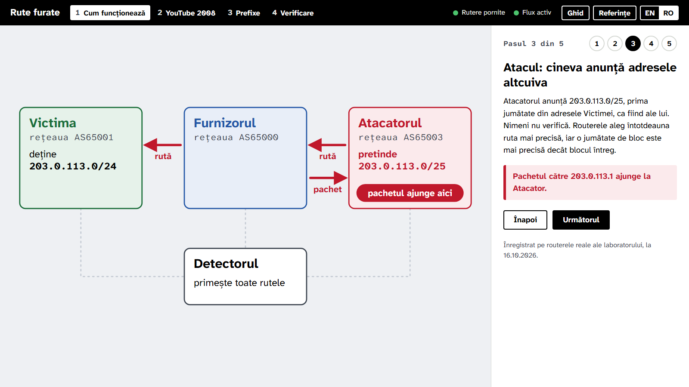
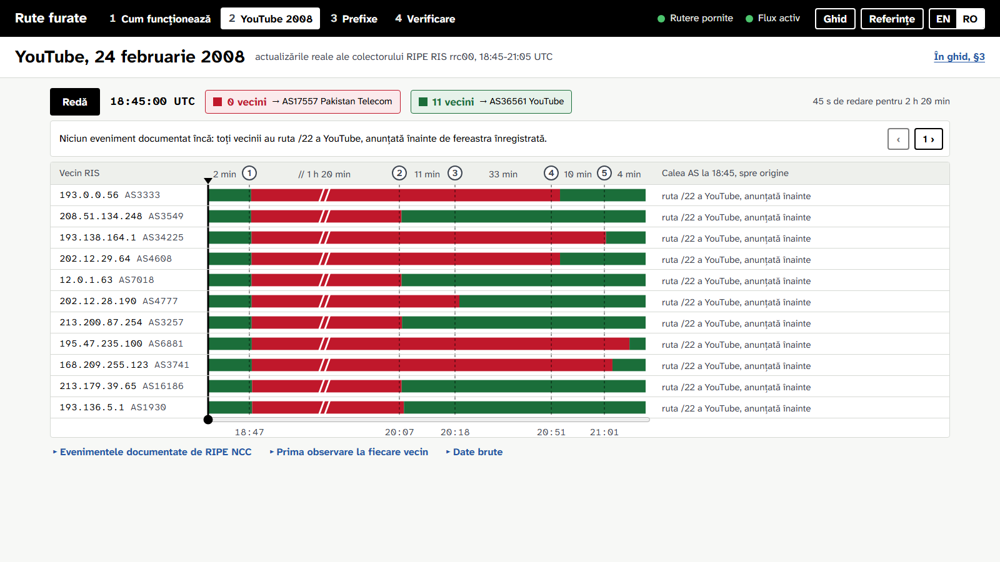
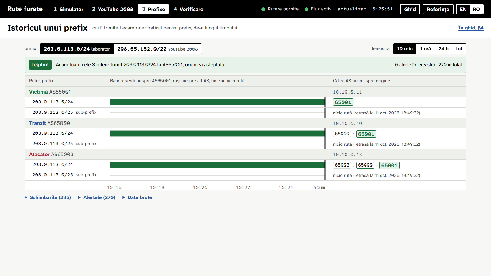
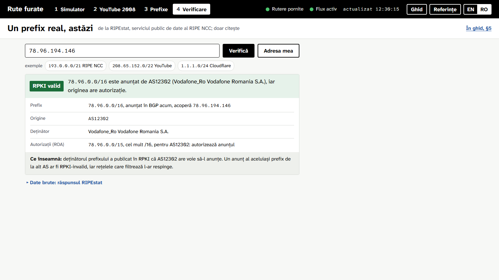
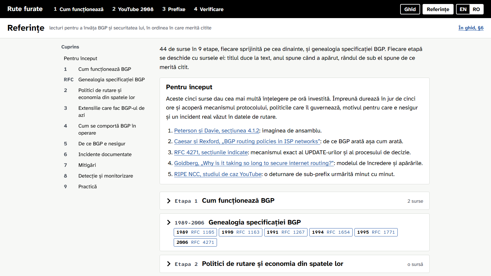
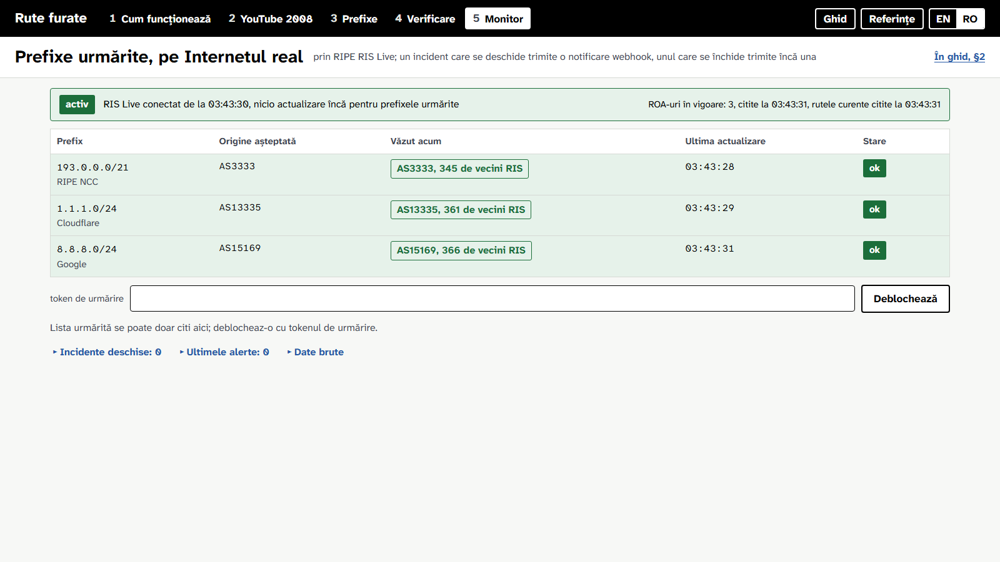

# Detector de deturnări de rute BGP

[English](README.md) | **Română**

Proiect pentru cursul PTIRC (masterul TCSI, Universitatea Națională de Știință și Tehnologie POLITEHNICA București). Un detector defensiv: urmărește anunțurile BGP pentru prefixele monitorizate și ridică o alertă când un alt sistem autonom le anunță. Tehnica este cea folosită de ARTEMIS (FORTH-ICS) și BGPalerter (NTT).

Detectează trei situații:

- **origine falsă**: prefixul exact, anunțat de un AS care nu îl deține;
- **sub-prefix**: o parte mai specifică a prefixului, anunțată de un AS străin;
- **RPKI-invalid**: un anunț pe care nicio autorizație de origine (ROA) nu îl permite.

Componente: un laborator cu trei rutere FRR, care își raportează rutele prin BMP (BGP Monitoring Protocol) către o stație de monitorizare; aplicația BGPWatch, scrisă în C# (stația BMP, clientul RIS Live care urmărește prefixe reale, detectorul, notificările webhook, linia de comandă, paginile web); o bază de date Postgres pentru istoricul rutelor și al alertelor; un parser BGP scris în C, care decodează atât mesajele din laborator, cât și datele reale din arhiva RIPE RIS.

**Demo public:** <https://student-dev.ro/bgp/?lang=ro> (aplicația), [`/guide`](https://student-dev.ro/bgp/guide?lang=ro) (ghidul de citit), [`/references`](https://student-dev.ro/bgp/references?lang=ro) (lecturile). Site-ul este implicit în engleză; comutatorul **EN | RO** din bara de sus sau `?lang=ro` în adresă îl trec în română, iar alegerea rămâne memorată.



## Capturi

| | |
|---|---|
|  |  |
| **YouTube 2008**, redat din actualizările reale RIPE RIS rrc00 | **Prefixe**: unde trimite fiecare ruter prefixul, de-a lungul timpului |
|  |  |
| **Verificare**: un prefix real, cu originea și starea RPKI de la RIPEstat | **Referințe**: 44 de surse în 9 etape |
|  | |
| **Monitor**: prefixele urmărite, originile pe care le dețin acum vecinii RIS, incidentele deschise | |

Capturile se refac cu `python scripts/screenshots.py`, în engleză în `media/` și în română în `media/ro/` (implicit de pe instanța publică; `--url http://localhost:8080/` pentru cea locală, `--views monitor` doar pentru unele dintre ele).

## Tehnologii

| Strat | Ce folosește |
|---|---|
| Laborator | FRRouting 10.4 în Docker Compose, rețea internă `10.10.0.0/24`, BMP Loc-RIB (RFC 7854, RFC 9069) |
| Parser | C11, bibliotecă partajată (`libmrt.so`, `mrt.dll`): MRT (RFC 6396) și UPDATE BGP, IPv4 și IPv6, AS4_PATH; fiecare citire verificată la limite, fiecare eșec raportat |
| Aplicație | C# pe .NET 10: ASP.NET Core, Razor Pages, API JSON minimal, P/Invoke spre parser, Docker Engine API prin socket |
| Limbi | un serviciu de traducere în C# peste câte un fișier JSON pe limbă (`Localization/strings.en.json`, `strings.ro.json`), folosit de pagini și de modulele din browser |
| Date | PostgreSQL 16 prin Npgsql (COPY binar, fără ORM); RIPE RIS Live prin WebSocket; RIPEstat Data API, cu cache de 10 minute |
| Pagină | module ES fără framework, SVG, fonturile Atkinson Hyperlegible Next și Mono |
| Teste și verificări | xUnit v3, Playwright pentru Python, ASan și UBSan pentru parser |

## Garanții de izolare

- Rețeaua laboratorului este internă (`internal: true` în `lab/docker-compose.yml`), fără uplink. Niciun anunț nu părăsește calculatorul.
- Ruterele folosesc numere AS private (65000, 65001, 65003) și prefixul de documentație `203.0.113.0/24` (RFC 5737). Stația BMP doar ascultă: nu are sesiuni BGP și nu anunță nimic.
- Deturnarea din laborator este un test: ruterul „atacator” anunță prefixul doar în această rețea închisă.
- Redarea incidentului din 2008 citește un fișier înregistrat și nu contactează nicio rețea.
- Local, pagina este publicată pe un port al calculatorului; pe server este servită sub prefixul `/bgp`. În ambele cazuri comandă laboratorul prin socket-ul Docker, deci oricine vede pagina poate declanșa și reseta deturnarea de test, și nimic altceva.
- Niciun pachet real nu traversează laboratorul: Docker aruncă pachetele adresate în afara subrețelei unei rețele interne. „Întreabă nucleele” citește decizia de rutare a fiecărui ruter în loc să trimită pachete.
- Vederea de verificare întreabă RIPEstat (`stat.ripe.net`) despre un prefix real și doar citește.
- Monitorul deschide un singur WebSocket de ieșire către RIPE RIS Live (`ris-live.ripe.net`) pentru prefixele urmărite, citește de la RIPEstat rutele lor curente și ROA-urile și trimite notificări doar către webhook-urile numite în fișierul de urmărire. Nimic nu anunță nimic: detectorul este un ascultător peste tot.

## Instalare, pornire, oprire

Pentru rularea aplicației este nevoie doar de Docker. Celelalte dependențe (SDK-ul .NET 10, gcc, Python cu Playwright) servesc la teste și la scripturile din `scripts/`.

### Instalare

- **Windows 10/11:** dublu-clic pe `install.bat`. Instalează prin winget Docker Desktop, SDK-ul .NET 10, MSYS2 cu gcc și Python 3.12, apoi Playwright cu Chromium și pachetele NuGet, și sare peste ce există deja. După prima instalare a Docker Desktop este nevoie de o repornire a calculatorului (cere WSL 2).
- **Debian sau Ubuntu:** `sh scripts/install-linux.sh`, rulat din rădăcina proiectului. Instalează Docker Engine cu pluginul compose, `build-essential`, SDK-ul .NET 10 în `~/.dotnet` și un `.venv` cu Playwright și Chromium.

### Pornire și oprire

- **Windows:** dublu-clic pe `start.bat`. Pornește Docker Desktop dacă este oprit, apoi laboratorul și detectorul, și deschide pagina. Pagina păstrează portul unui stack deja pornit sau ia primul port local liber între 8080 și 8099. Prima pornire construiește imaginile și durează câteva minute. Oprirea se face cu dublu-clic pe `stop.bat`; istoricul rutelor și alertele rămân în volumul Docker.
- **Linux sau macOS**, din rădăcina proiectului (`BGP_PORT` alege portul local, 8080 dacă lipsește; `.env.example` enumeră variabilele pe care le poate seta un `.env` alături):

```sh
# pornire: laboratorul, apoi detectorul (stația BMP, Postgres, pagina)
docker compose -f lab/docker-compose.yml up -d
BGP_PORT=8080 docker compose up -d --build --remove-orphans

# oprire
docker compose down
docker compose -f lab/docker-compose.yml down
```

### Comenzi Docker utile

```sh
docker compose ps                                   # starea aplicației și a bazei de date
docker compose logs -f app                          # jurnalul aplicației
docker compose port app 8080                        # portul local pe care este publicată pagina
docker compose -f lab/docker-compose.yml ps         # cele trei rutere
docker exec lab-transit vtysh -c "show ip bgp"      # tabela BGP a ruterului de tranzit
docker exec lab-transit vtysh -c "show bmp"         # sesiunea lui BMP către stație
docker compose -f lab/docker-compose.yml up -d --force-recreate   # după o schimbare în lab/frr/
docker compose down -v                              # oprește și ȘTERGE istoricul din Postgres
```

Parola Postgres din `docker-compose.yml` (`bgp`) este valoarea implicită a demo-ului local; baza nu are port publicat.

## Ce face fiecare parte

Pagina de pornire este aplicația: cinci vederi în bara de sus (Cum funcționează, YouTube 2008, Prefixe, Verificare, Monitor) și butoanele „Ghid” și „Referințe”. Ghidul (`/guide`) are șase capitole scurte de citit de sus în jos, primele cinci cu harta poveștii la pasul pe care îl descriu și o legătură către acel pas; fiecare vedere a aplicației trimite la capitolul ei din ghid. În ghid, termenii subliniați punctat deschid o definiție. Referințele (`/references`) sunt lecturile pentru a învăța BGP, pe etape, cu genealogia specificației de la RFC 1105 la RFC 4271.

1. **Cum funcționează.** O deturnare de rută în cinci pași, pentru un cititor care n-a auzit de BGP: în stânga, o hartă fixă a laboratorului; în dreapta, un singur panou de text; „Înapoi” și „Următorul” (sau punctele numerotate) pentru a avansa. Pașii: o rețea își anunță adresele, un pachet merge unde spun rutele, atacatorul pretinde jumătate din bloc și pachetul ajunge la el, detectorul dă alarma (cu întârzierea reală), iar validarea originii la furnizor, față de RPKI, respinge rutele atacatorului. Fiecare fapt vine dintr-un ciclu înregistrat pe routerele reale ale laboratorului (`static/story/cycle.json`, scris de `scripts/record_story.py`), așa că povestea merge și cu laboratorul oprit. La ultimul pas, „Rulează atacul pe routerele reale” anunță sub-prefixul în laborator, spune când a dat detectorul alarma și unde a ajuns pachetul, apoi retrage atacul. `#step-N` deschide pasul N.
2. **YouTube 2008.** Tot incidentul pe un singur ecran: un rând pentru fiecare dintre cei 11 vecini ai colectorului rrc00, cu banda care arată cui îi trimitea traficul pentru blocul deturnat (roșu către AS17557, verde către YouTube) și, la dreapta, calea AS din momentul ales, cu sistemul autonom care predă ruta originii încadrat. Axa benzilor este împărțită în faze la cele cinci evenimente documentate: fiecare fază are lățimea după rădăcina pătrată a duratei, cu durata reală scrisă deasupra, iar faza comprimată mult (cele 80 de minute ale deturnării) poartă semnul de rupere //. Deasupra stau „Redă” (cursorul merge cu viteză constantă pe bandă, iar eticheta arată ritmul fazei curente), ora și câți vecini trimit spre fiecare origine, apoi evenimentul documentat de RIPE NCC din momentul ales, cu butoane spre cel anterior și cel următor. Tragerea pe benzi sau pe bara de sub ele derulează incidentul. Evenimentele, prima observare la fiecare vecin și datele brute stau închise sub tabel. Actualizările BGP reale (18:45-21:05 UTC, 136.344 de actualizări) se încarcă o singură dată la pornire; detectorul ridică 31 de alerte de sub-prefix, prima la 18:47:57 UTC. „Reîncarcă incidentul din fișiere”, în datele brute, le rescrie fără dubluri.
3. **Istoricul unui prefix.** Sus se aleg prefixul urmărit și fereastra (10 min, 1 oră, 24 h, tot). Verdictul spune unde trimite fiecare ruter prefixul acum. Dedesubt, fiecare ruter are câte un rând pentru fiecare prefix văzut (prefixul urmărit și sub-prefixele lui), cu banda în fereastră (verde spre originea așteptată, roșu spre alt AS, linie subțire fără rută) și calea de acum. Schimbările, alertele și datele brute stau închise dedesubt.
4. **Un prefix real.** Un prefix sau o adresă scrise în câmp, un exemplu sau „Adresa mea”. Răspunsul începe cu verdictul RPKI, apoi prefixul care acoperă adresa, originea, deținătorul, autorizațiile (ROA) și semnificația stării RPKI, de la RIPEstat. Doar citește.
5. **Monitor.** Prefixele urmărite pe Internetul real (secțiunea următoare): starea fluxului RIS Live, câte un rând pentru fiecare prefix cu originile așteptate, originile pe care le dețin acum vecinii RIS (câți vecini fiecare, roșu când nu este așteptată), ultima actualizare și starea, apoi incidentele deschise și ultimele alerte. De pe mașina care rulează detectorul, sau cu tokenul de urmărire, rândul de sub tabel adaugă un prefix (originile așteptate și deținătorul vin de la RIPEstat odată ce prefixul este scris), adaugă toate prefixele unui AS sau trimite o notificare de test; „Acceptă și AS...” pe o origine roșie și „Elimină” editează un rând.

## Urmărirea prefixelor reale

Detectorul urmărește prefixe reale la fel cum urmărește laboratorul: punctele de observare sunt vecinii RIS ai colectoarelor de rute ale RIPE NCC, transmise în flux de [RIS Live](https://ris-live.ripe.net/) (un WebSocket gratuit, fără cheie), iar cele trei verificări sunt aceleași. La pornire și ori de câte ori se adaugă un prefix, rutele lui curente, și ale fiecărui prefix anunțat în interiorul lui de o origine neașteptată, se citesc din looking glass-ul RIPEstat și trec prin detector, așa că o deturnare deja în curs este prinsă imediat; ROA-urile care acoperă prefixele urmărite și prefixele anunțate în interiorul lor se citesc tot de la RIPEstat, la pornire și o dată pe oră, pentru verificarea RPKI.

Fișierul de urmărire `watch/bgpwatch.toml` ține totul (`watch/example.toml` este exemplul comentat; fișierul real nu se publică niciodată):

```toml
[[monitored]]
prefix = "193.0.0.0/21"
expected_origins = [3333]
description = "RIPE NCC"

[[webhook]]
name = "ops"
url = "https://example.org/hooks/bgp"
```

Alertele unui prefix și ale unei origini străine formează un incident. Un webhook primește un obiect JSON când un incident se deschide, unul când se închide (zece minute fără nicio alertă și niciun vecin nu mai deține o rută care ar ridica una: ruta a fost retrasă sau originea ei este acum așteptată) și unul la test; niciodată unul pentru fiecare actualizare. Deturnarea proprie a laboratorului, rulată din poveste, trece prin același birou sub sursa `lab`, deci webhook-ul se poate încerca fără a aștepta o deturnare reală:

```json
{"kind": "opened", "source": "ris", "at": "2026-11-06T18:40:01Z",
 "text": "more-specific 193.0.1.0/24 of monitored 193.0.0.0/21 announced by AS64496, expected AS3333; seen by 12 vantage points",
 "incident": {"prefix": "193.0.0.0/21", "origin": 64496, "expected_origins": [3333], "first_seen": "...", "last_seen": "...",
              "alerts": 12, "peers": ["rrc21 5.57.80.113"], "prefixes": ["193.0.1.0/24"], "alert_types": ["subprefix_hijack"], "detail": "..."}}
```

Pagina editează prefixele fișierului; webhook-urile se editează doar în fișier. Pe instanța publică, editările cer tokenul din `WATCH_TOKEN`; fără token, doar un client dintr-o rețea privată (mașina care rulează stack-ul) poate edita. Pagina adaugă prefixe de cel puțin /8 (IPv4) sau /16 (IPv6), cel mult 50 de la un AS și 100 în total; linia de comandă nu are aceste limite. Detectorul în funcțiune aplică fișierul în cel mult cinci secunde de la orice schimbare.

Linia de comandă, `bgp-watch`, rulează același cod fără pagină. `bgp-watch.bat` (Windows) sau `./bgp-watch.sh` o rulează în container cât timp stack-ul e pornit, altfel build-ul local (`dotnet build BGPWatch.slnx` după `sh detector/mrt/build.sh`). `bgp-watch help` afișează manualul în forma unei pagini man, iar `bgp-watch help <comanda>` secțiunea unei singure comenzi:

| Comanda | Ce face |
|---|---|
| `help [COMANDA]` | manualul, sau secțiunea unei comenzi |
| `prefixes list` / `prefixes add PREFIX ASN... [--description TEXT]` / `prefixes remove PREFIX` | citește și editează fișierul de urmărire |
| `check PREFIX` | ce vede RIPEstat astăzi pentru prefix, față de fișier; cod de ieșire 2 la o origine neașteptată |
| `watch [--json]` | un monitor fără pagină: alertele și incidentele pe stdout (ore UTC), webhook-urile active, fără bază de date |
| `replay FILE... [--json]` | detectorul peste fișiere MRT (înregistrarea din 2008, de pildă); cod de ieșire 2 când a ridicat ceva |
| `notify test` | câte o notificare de test pentru fiecare webhook |
| `serve` | aplicația web însăși, ceea ce rulează containerul |
| `dump FILE`, `measure CONFIG FILE` | verbele autorului: fiecare rută dintr-un fișier MRT și o măsurătoare a detectorului pe el |

`--config FILE` numește alt fișier de urmărire (implicit: `WATCH_CONFIG`, apoi `watch/bgpwatch.toml`); `--json` scrie câte un obiect JSON pe linie, în cuvintele încărcăturii webhook.

Limite de știut: RIS Live transmite actualizări, nu tabele, așa că rutele citite de la RIPEstat sunt ce știe monitorul la pornire; o repornire anunță din nou un incident încă în curs. Un prefix legitim care începe să fie anunțat în interiorul unuia urmărit poate ridica alerte RPKI-invalid timp de cel mult nouă ore: RIPEstat îl listează în cel mult opt, iar ROA-urile lui se citesc la următoarea reîmprospătare orară.

## Lecturi suplimentare

- `src/BGPWatch.Web/Reading/readings.ro.md` și `readings.en.md`: lista de lecturi despre BGP, în română și în engleză, pe etape, cu genealogia specificației; pagina `/references` se generează din ele.
- `detector/incidents/youtube-2008/config.toml`: sursa datelor redate, prefixul monitorizat și cronologia documentată a incidentului, în ambele limbi.

## Structură

- `lab/`: configurațiile FRR și scripturile care pornesc și opresc deturnarea de test.
- `src/BGPWatch.Core/`: nucleul, fără dependențe: modelul de domeniu, detecția, gruparea alertelor în incidente, istoricul unui prefix, cazurile de utilizare.
- `src/BGPWatch.Web/`: adaptoarele și gazda: stația BMP, legătura cu parserul C, Postgres, Docker, RIPEstat, API-ul, serviciul de traducere (`Localization/`) și paginile (Razor Pages, `wwwroot/static/`).
- `tests/BGPWatch.Tests/`: testele unitare.
- `detector/mrt/`: parserul BGP și MRT în C, cu harness-ul de fuzzing sub sanitizers.
- `detector/incidents/`, `detector/config.toml`, `detector/schema.sql`: datele incidentului din 2008, configurația laboratorului și schema bazei de date.
- `watch/`: fișierul de urmărire al monitorului de Internet real (`example.toml` comentat; `bgpwatch.toml` este al tău, nepublicat niciodată); `bgp-watch.bat` și `bgp-watch.sh` rulează linia de comandă.
- `scripts/`: instalatoarele, verificarea paginii, măsurătorile laboratorului, fuzzing-ul parserului, capturile din `media/`.
- `docker-compose.yml` este forma de producție; `docker-compose.override.yml` (încărcat implicit) adaugă portul local și fișierele montate din arborele de lucru; `docker-compose.server.yml` și `deploy/nginx-bgp.conf` sunt stratul pentru server.

## Teste și verificări

- Teste unitare: `sh detector/mrt/build.sh`, apoi `dotnet test --solution BGPWatch.slnx`; modulele din browser: `node --test "tests/js/*.test.mjs"`.
- Verificarea paginii, cu stack-ul pornit: `python scripts/check_page.py` (ambele limbi la 390, 1366 și 1920 px: depășiri, erori de script, mărimea și coliziunile textului de pe hartă, contrastul culorilor, emoji).
- Fuzzing-ul parserului sub ASan și UBSan: `python scripts/fuzz_mrt.py 20000`.

## Licență

MIT, vezi [LICENSE](LICENSE). Fonturile Atkinson Hyperlegible incluse sunt sub SIL Open Font License; fișierele RIPE RIS din 2008 sunt date ale RIPE NCC.
